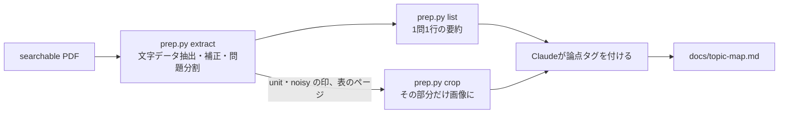

# 参考書PDFの取り込み手順

参考書のスキャンPDFから論点・出題形式・頻度を抜き出し、`docs/topic-map.md` にまとめるまでの手順。
PDFと、そこから抽出した本文は著作物のためコミットしない（`references/` と `*.pdf` は `.gitignore` 済み）。

## スキャン

| 項目 | 設定 | 理由 |
|---|---|---|
| 形式 | searchable PDF | 文字データを使ってページを絞り込み、文章のページは画像を見ずに読むため |
| 補正 | 自動調整をオン | 見開きの隣のページが混入しなくなり、ファイルも軽くなる |
| 単位 | 問題と解答でファイルを分ける | 解答ページは原則として読まないため |

ファイル名は `<書名>-<回>-<q|a>.pdf` とする（例：`tac-mondai-02-q.pdf`）。
OCRは見出しの回数を読み違える（「第2回」→「第4回」）ため、出典の回はファイル名から取る。

## 流れ



```sh
python3 tools/pdf/prep.py extract path/to/tac-mondai-02-q.pdf   # → references/tac-mondai-02-q/
python3 tools/pdf/prep.py list references/tac-mondai-02-q
python3 tools/pdf/prep.py crop path/to/tac-mondai-02-q.pdf --page 8 --table
```

依存は poppler-utils（`pdftotext` / `pdftoppm` / `pdfinfo`）のみ。同じPDFを再度 `extract` しても、内容が変わっていなければスキップする。

## 出力

| ファイル | 内容 |
|---|---|
| `meta.json` | 元ファイル名、SHA-256、書名・回・種別、ページ数 |
| `pages.jsonl` | ページごとの補正済みテキスト、表の範囲、要確認の行 |
| `questions.jsonl` | 1問1行。大問・小問・設問番号、問題文、選択肢、出典（第○回第○問／サンプル問題○）、flags |

`flags` の意味：

- `unit`：㎡などの単位まわりで数値が化けている可能性がある（例：550㎡ → 5508）。数値が論点の判断に要るときだけ画像で確認する
- `noisy`：OCRのゴミが多い行を含む。問題文の意味が取れなければ画像で確認する

## 補正の範囲

| 誤り | 例 | 扱い |
|---|---|---|
| 選択肢記号の取り違え | 工→エ、力→カ、才→オ、ァ→ア | 自動で補正する |
| 円記号 | 早3,000 → ¥3,000 | 自動で補正する |
| 金額中の文字 | 26,00〇 → 26,000、1.320,000 → 1,320,000 | 自動で補正する |
| 選択肢の読み順の前後 | カがアより先に読まれる | 記号順に並べ直す |
| 単位の化け | 550㎡ → 5508 | 補正しない。`unit` の印を付ける |
| 表（精算表・T勘定・解答欄） | 数値の取り違え（165,500 → 163,500 など） | 文字データは使わない。`crop --table` の画像で読む |
