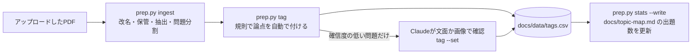

# 参考書PDFの取り込み手順

参考書のスキャンPDFから論点・出題形式・頻度を抜き出し、`docs/topic-map.md` にまとめるまでの手順。
PDFと、そこから抽出した本文は著作物のためコミットしない（`references/` と `*.pdf` は `.gitignore` 済み）。

## スキャン

| 項目 | 設定 | 理由 |
|---|---|---|
| 形式 | searchable PDF | 文字データを使ってページを絞り込み、文章のページは画像を見ずに読むため |
| 補正 | 自動調整をオン | 見開きの隣のページが混入しなくなり、ファイルも軽くなる |
| 単位 | 問題と解答でファイルを分ける | 解答ページは原則として読まないため |

ファイル名は `<書名>-<回>-<q|a>.pdf` とする（例：`tac-mondai-02-q.pdf`）。複数回を1つのPDFにまとめて送られた場合は、`pdfseparate` と `pdfunite` で回ごとのファイルに分けてから取り込む。
OCRは見出しの回数を読み違える（「第2回」→「第4回」）ため、出典の回はファイル名から取る。

旧範囲（2022年度適用の出題区分表より前）の本は、書名を変えて（例：`tachonshi2021-01-q.pdf`）`--scope old` で取り込む。

## 流れ



```sh
python3 tools/pdf/prep.py ingest /root/.claude/uploads/<id>/          # フォルダ内のPDFをまとめて取り込む
python3 tools/pdf/prep.py ingest tachonshi2021-01-q.pdf --scope old  # 旧範囲の本
python3 tools/pdf/prep.py status                                     # 本ごとの問題数・読み落とし・タグの進み具合
python3 tools/pdf/prep.py tag                                        # 自動タグ。要確認の問題だけ1行ずつ表示する
python3 tools/pdf/prep.py tag --set tachonshi-02-1-7=notes:電子記録債権の発生記録
python3 tools/pdf/prep.py tag --set tachonshi2021-01-1-3=-           # 範囲外として集計から外す
python3 tools/pdf/prep.py tag --not-dup tachonshi-11-1-12           # 文が似ているだけで別の問題（重複の誤判定を取り消す）
python3 tools/pdf/prep.py stats --write
python3 tools/pdf/prep.py crop references/pdf/tachonshi-03-q.pdf --page 4 --dpi 90  # 読み落としの確認
```

依存は poppler-utils（`pdftotext` / `pdftoppm` / `pdfinfo`）のみ。同じPDFを再度取り込んでも、内容が変わっていなければスキップする。

## タグ付け

対象は第1問の各設問と、第3問の決算整理事項。第2問は形式ごとに `docs/topic-map.md` へ手で書く。

| by | 意味 | 集計 |
|---|---|---|
| auto | 規則の1位が2位より十分に高い | 含める |
| review | 候補が拮抗している、読み落とし、旧範囲の手がかり（有価証券・為替手形など）がある | 含めない |
| manual | `tag --set` で確認・設定した。再実行しても上書きされない | 含める（論点が `-` なら除く） |

- 規則は `tools/pdf/tagging.py` の `RULES`。手で付けたタグとの一致率は `tag --eval` で確認する（第1〜4回の60問で、確信度ありの55問はすべて一致）
- 旧範囲の本の問題は、論点マスタ（`src/content/topics.ts`）の論点に当たるものだけを集計する。旧範囲の手がかりの一覧は公式の区分表と照合していないため、該当した問題は自動で除外せず要確認にする

## 重複の判定

同じ問題が複数の本に載っていても、集計では1回だけ数える（先に取り込んだ現行範囲の本を残す）。

| 大問 | 同じ問題とみなす条件 |
|---|---|
| 第1問 | 設問まで書かれた出典（「サンプル問題3-問14」）が同じ、または金額・記号を除いた文の類似度が0.6以上 |
| 第3問 | 大問の出典（「第147回第5問」）が同じで、設問番号が同じ。「消費税の処理を行う」のような定型文が多いため、文の類似では判定しない |

## 出力

| ファイル | コミット | 内容 |
|---|---|---|
| `references/<名前>/meta.json` | しない | 元ファイル名、SHA-256、書名・回・種別・範囲、ページ数 |
| `references/<名前>/pages.jsonl` | しない | ページごとの補正済みテキスト、表の範囲、要確認の行 |
| `references/<名前>/questions.jsonl` | しない | 1問1行。大問・小問・設問番号、問題文、選択肢、出典、flags |
| `docs/data/tags.csv` | する | 1問1行。ID・出典・論点ID・by・重複先・自分で書いた要約。問題文は含めない |

`flags` の意味：

- `missing`：設問番号が読めなかった。文中から取り戻せなければ、画像で確認する
- `recovered`：表と本文が入り組んで前の設問に吸収されていたものを、文中の「。3.」から取り戻した。表の文字が混ざりうる
- `unit`：㎡などの単位まわりで数値が化けている可能性がある（例：550㎡ → 5508）。数値が論点の判断に要るときだけ画像で確認する
- `noisy`：OCRのゴミが多い行を含む。問題文の意味が取れなければ画像で確認する

## 補正の範囲

| 誤り | 例 | 扱い |
|---|---|---|
| 選択肢記号の取り違え | 工→エ、力→カ、才→オ、ァ→ア | 自動で補正する |
| 円記号 | 早3,000 → ¥3,000 | 自動で補正する |
| 金額中の文字 | 26,00〇 → 26,000、1.320,000 → 1,320,000 | 自動で補正する |
| 選択肢の読み順の前後 | カがアより先に読まれる | 記号順に並べ直す |
| 単位の化け | 550㎡ → 5508 | 補正しない。`unit` の印を付ける |
| 表（精算表・T勘定・解答欄） | 数値の取り違え（165,500 → 163,500 など） | 文字データは使わない。`crop --table` の画像で読む |
| 第1問の見出し | 第1問 → 第［問 | 1とみなす。見出しが読めなくても、最初の見出しが第2問なら、それより前を第1問とする |
| 出典の区切り | サンプル問題3-問14 → サンプル問題3一問14 | 設問番号付きの出典として読む |
